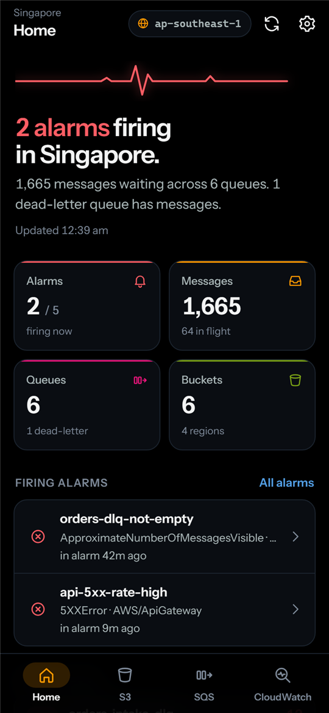
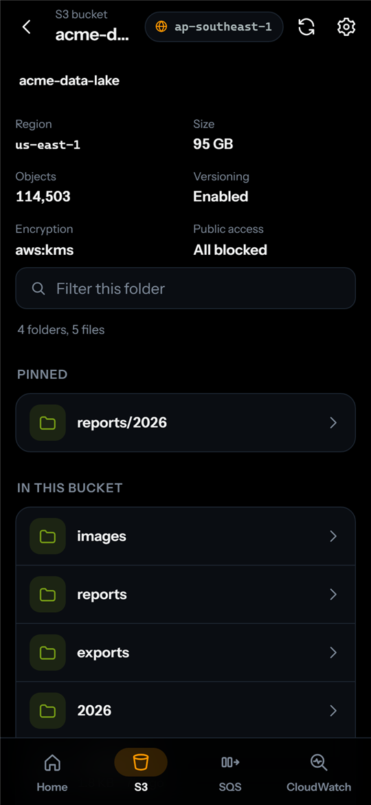
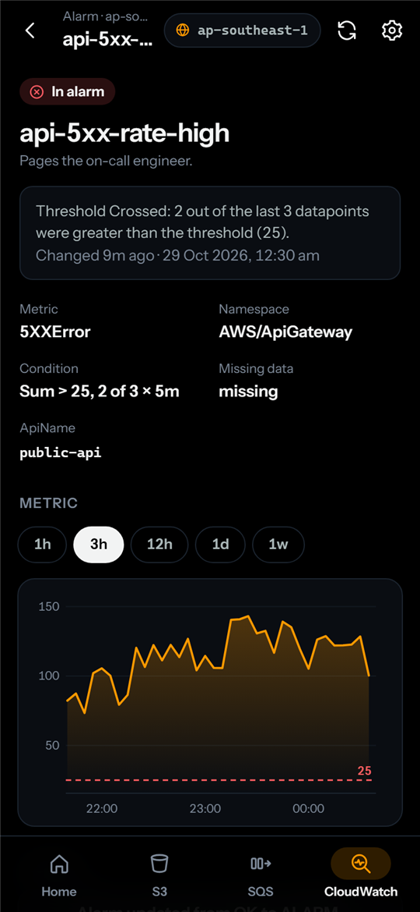
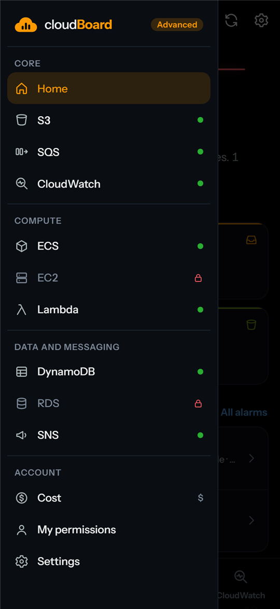

# cloudBoard

A read-only Android app for checking your AWS account from your phone: S3 buckets, SQS queues, and CloudWatch alarms, metrics and logs. AMOLED black with the AWS palette.

<p>
  
  
  
  
</p>

## Install

Download `cloudBoard.apk` from the [latest release](https://github.com/atikulmunna/cloudboard/releases/latest), open it on your phone and allow installs from that source. Needs Android 7.0 or newer. Then enter an IAM user's access key ID and secret access key.

## What it shows

- **Home**: firing alarms, messages waiting, dead-letter queues that have messages, and bucket count. Refreshes every minute.
- **S3**: buckets from every region, a folder browser, size, object count, versioning, encryption and public access. File preview for text, JSON and images, plus 15-minute signed links to open or download.
- **SQS**: queues with available, in-flight and delayed counts, dead-letter routing, CloudWatch charts (available, sent vs received, oldest message age), and a peek at up to 10 messages.
- **CloudWatch**: alarms with the metric chart, threshold line and state history. A metric browser by namespace with range and statistic pickers. Log groups, streams, filter-pattern search across streams, and a live-follow log viewer.

The region button at the top switches the region for SQS and CloudWatch. S3 always lists every region.

**Pins**: long-press any bucket, folder, file, alarm, metric or log group and choose Pin to top. Long-press it again to unpin. Pinned items show in a "Pinned" section at the top of their list. Pinned files and folders also show at the bucket's top level, and pinned metrics show on the Metrics tab. CloudWatch pins are saved per region.

**Theme**: Settings → Appearance has System (default, follows your phone), Light (AWS console palette) and Dark (true AMOLED black).

### Advanced mode

Turn it on in Settings to get a menu (top left) with more services:

- **ECS**: clusters, services with running/desired counts and deployment state, tasks (including why stopped tasks stopped), events, CPU and memory.
- **EC2**: instances by state, IPs, details, tags, CPU, network and status checks.
- **Lambda**: functions, configuration, invocations, errors, duration, concurrency, and a link to the function's logs.
- **DynamoDB**: tables, keys, indexes, size, item count and capacity used.
- **RDS**: clusters and instances, endpoints, CPU, connections, memory and storage.
- **SNS**: topics, subscriptions, published messages and deliveries.
- **Cost**: month-to-date spend, pace for the month and spend by service. AWS charges $0.01 per Cost Explorer request, so it only loads when you tap and the result is kept on the phone.
- **My permissions**: an access check across every service (one harmless read each) plus your user's IAM policies, if it is allowed to read them.

The menu marks services your IAM user is not allowed to use with a lock. Advanced mode is still read-only.

## Security

- The keys are encrypted with an AES-256-GCM key held in the **Android Keystore**. The web layer can save or clear the keys but can never read the secret back.
- Every request is signed (SigV4) in native code (`SigV4.java`). Requests only go to `https://*.amazonaws.com`.
- **Read-only is enforced natively** (`ReadOnlyPolicy.java`): S3 allows only GET and HEAD, and every other call must be on an allowlist of read actions. Message peeks are forced to `VisibilityTimeout=0`, so messages stay visible to your consumers. AWS still counts each peek as a receive, which matters for queues with a redrive policy.
- Backups and device transfer are turned off. Cleartext HTTP is off.

Use a dedicated IAM user. The minimal policy is in Settings → Minimal IAM policy (and `IAM_POLICY` in `public/aws.js`).

## Build

Needs Node 18+, Android Studio (for its JDK 21) and the Android SDK.

```
npm install
npm run android -- --install            # debug build, installs on a USB-connected phone
npm run android -- --release --install  # release build
npm run android -- --test               # also runs the native unit tests (SigV4 vectors, read-only policy)
npm run icons                           # regenerate launcher icons and splash screens
```

APKs are written to `dist/`.

## Preview in a browser

Serve `public/` (for example `python -m http.server -d public`) and open `index.html?demo`. This shows the interface with made-up data. Real requests only work in the Android app.

## License

MIT
