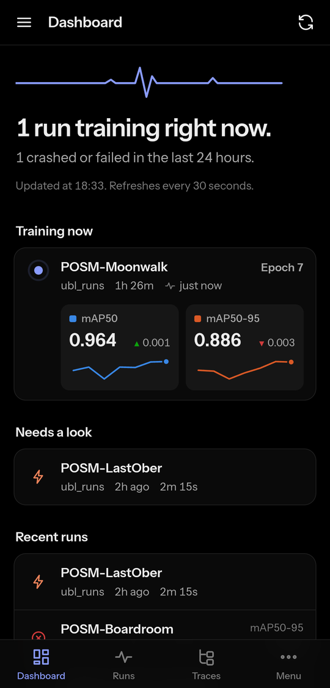
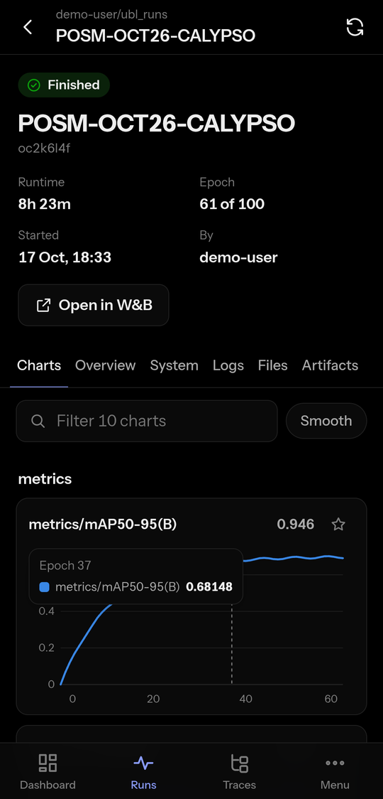
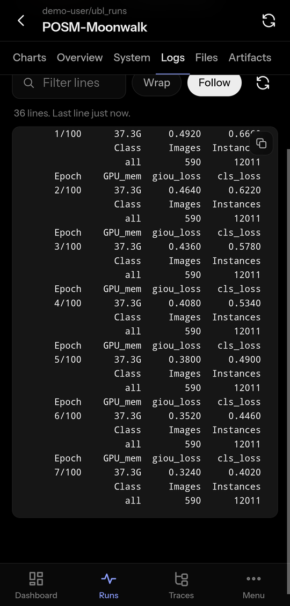

<p align="center">An Android app for monitoring Weights &amp; Biases training runs from your phone.</p>

<p align="center">
  
  
  
  
</p>

## Features

- Dashboard of live, crashed and recently finished runs across your projects and teams, refreshed every 30 seconds
- Object detection runs (Ultralytics YOLO, RT-DETR) show the epoch and mAP50 and mAP50-95 with their trend
- Run pages with metric charts, summary and config, GPU/CPU/memory, live console logs, files and artifacts
- Sweeps, artifacts, registry, reports and Weave traces
- Stop a run, or pause, resume and stop a sweep, each after a confirmation (can be turned off)
- AMOLED black theme, with a light theme in Settings

## Install

Download `watchBoard.apk` from the [latest release](https://github.com/atikulmunna/things-nobody-asked-for/releases/tag/watchboard-v1.0.1), open it on your phone and allow the install. On first launch, paste your API key from [wandb.ai/authorize](https://wandb.ai/authorize). W&B Dedicated Cloud and self-hosted servers can set their own API host on the same screen.

Requires Android 7.0 or newer.

## Privacy

- The API key is stored in the app's private storage on the device and excluded from Android backups. It is not encrypted with the Android Keystore.
- Requests go only to your W&B API and Weave trace hosts (`api.wandb.ai` and `trace.wandb.ai` by default). There is no other server.
- The app only reads data, apart from the run and sweep controls above.

## How it works

The interface is plain HTML, CSS and JavaScript in `public/`, packaged as an Android app with [Capacitor](https://capacitorjs.com). The W&B API does not accept cross-origin browser requests, so the app sends them through a small native HTTP plugin (`android/app/src/main/java/dev/watchboard/app/RawHttpPlugin.java`). GraphQL queries are in `public/queries.js` and follow the official `wandb` SDK.

## Build from source

Requires Node.js 18 or newer and Android Studio.

```
npm install
npm run android -- --release    # dist/watchBoard.apk
npm run android -- --install    # debug build, installed on a phone over USB
```

A build from source is signed with your own key, so uninstall the release app before installing it.

## Browser version

`server.js` serves the same interface to browsers on your network and keeps the API key on the computer. Devices unlock it with a passcode printed at startup.

```
cp .env.example .env    # add WANDB_API_KEY
npm start
npm run check           # runs every query against your account
```

## License

MIT. Not affiliated with Weights & Biases or CoreWeave.
