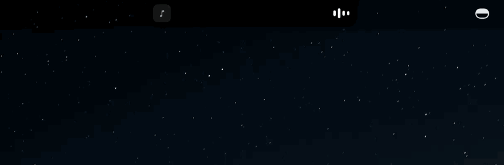

<p align="center">A Liquid Glass notch for your Mac: now playing, calls, clipboard, Claude Code activity and screenshots.</p>

<p align="center">
  
</p>

## Features

- **Liquid Glass** that springs out of the hardware notch when you hover it. Three looks in the menu bar: Waterdrop (lensing glass over frost, the default), Frosted and Clear.
- **Now playing** for any app, browsers included: artwork, title, scrubber and controls. While audio plays, the closed notch shows the artwork and an equalizer.
- **Calls** in WhatsApp, FaceTime, Zoom, Teams, Slack, Discord, Telegram, Meet and others: the app's icon and a call timer in the notch, plus mute and end call.
- **Clipboard**: recent text, images and files as a scrolling list of glass cards. Click one to copy it again.
- **Claude Code**: what each session is doing (thinking, editing, running, reading, searching), its steps and files edited, a little pixel character in the notch while it works and a checkmark when it's done, plus your 5-hour and weekly usage limits.
- **Screenshots**: your latest screenshots to open, copy, drag into any app or move to the Trash, plus Capture Area and Capture Text (the text in an area is recognized on the Mac and copied).
- Hides its live activities in fullscreen and brings them back when the pointer moves toward the notch.

## Install

Download `GlassNotch-1.2.dmg` from the [latest release](https://github.com/atikulmunna/things-nobody-asked-for/releases/tag/glassnotch-v1.2), open it and drag GlassNotch into Applications.

The app isn't notarized by Apple, so macOS blocks it the first time you open it: click Done, then open System Settings › Privacy & Security and click **Open Anyway** next to GlassNotch. You only need to do this once.

Requires macOS 14 Sonoma or newer (call detection needs 14.2). The Liquid Glass look needs macOS 26 Tahoe; Sonoma and Sequoia get the classic frosted blur with the same features. Made for MacBooks with a notch; on other displays GlassNotch draws a small black notch at the top.

## Privacy

- GlassNotch doesn't connect to the internet and collects nothing.
- Clipboard history lives only in memory, and items that password managers mark as concealed are skipped.
- macOS permissions are asked for only when you use the feature that needs them, with an explanation first:
  - **Desktop folder**: to show your recent screenshots.
  - **Screen Recording**: only to capture the area you select.
  - **Accessibility** (optional): only to press your call app's End button when you click End in the notch. Call detection and mute need no permission.
- **Claude usage limits** are optional (Pro, Max and Ultra plans). "Connect Claude Usage Limits…" in the menu sets a small status line script in Claude Code's settings, backed up first, that hands the 5-hour and weekly numbers to GlassNotch. No credentials are read, and your terminal looks the same.

## How it works

- A borderless panel sits over the notch. The open pill is SwiftUI on top of AppKit's `NSGlassEffectView`, shaped to the notch outline. The Waterdrop and Clear looks use private glass variants; if a future macOS removes them, the app falls back to the standard material.
- Now playing comes from [MediaRemoteAdapter](https://github.com/ungive/mediaremote-adapter), since MediaRemote is restricted for apps on recent macOS.
- Calls: Core Audio reports which app is using the microphone. Mute mutes the Mac's microphone itself, so it works in every app (the app's own mute button doesn't change), and it's undone when the call ends. End presses the app's own End, Leave or Hang up button through Accessibility and never presses "End for all"; if it finds none, it brings the app forward.
- Claude Code activity is read from the session transcripts in `~/.claude*/projects`.
- Fullscreen is detected from the type of the current Space (SkyLight, private).

## Build from source

Requires Xcode 26 or newer.

```
./build.sh install    # build and install into /Applications
Scripts/package.sh    # dist/GlassNotch-<version>.dmg, for Apple silicon and Intel
```

Builds are signed ad hoc with the bundle ID as the designated requirement, so permissions survive rebuilds. To sign and notarize with a Developer ID:

```
xcrun notarytool store-credentials glassnotch --apple-id you@example.com --team-id TEAMID
SIGN_IDENTITY="Developer ID Application: Your Name (TEAMID)" NOTARY_PROFILE=glassnotch Scripts/package.sh
```

`swift Scripts/make-icon.swift` redraws the app icon. Debug switches (environment variables): `GLASSNOTCH_PIN=expanded|peeking|collapsed`, `GLASSNOTCH_TAB=media|clipboard|agents|screenshots`, `GLASSNOTCH_BACKDROP=1`, `GLASSNOTCH_DEMO=1`, `GLASSNOTCH_FORCE_FALLBACK=1` (the macOS 14–15 look), `GLASSNOTCH_FAKE_CALL=<bundle id>`, `GLASSNOTCH_SAMPLE_CLIPS=1`, `GLASSNOTCH_LIMITS_FILE=<path>`, `GLASSNOTCH_IGNORE_FULLSCREEN=1`, `GLASSNOTCH_TRACE=1`. Quit the installed app first, since a second copy exits on launch. `open --env GLASSNOTCH_DIAG=/tmp/diag.txt /Applications/GlassNotch.app` writes whether Screen Recording is granted.

## License

MIT. Not affiliated with Apple or Anthropic. MediaRemoteAdapter is BSD 3-Clause (`Vendor/mediaremote-adapter/LICENSE`).
